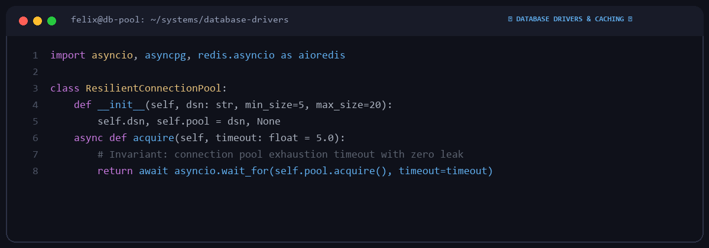

# Felix Bauer

  

Backend systems engineer based in Munich, Germany.  
Specializing in database drivers, connection lifecycles, and high-throughput caching layers.

---

### 🗄️ Open Source Projects & Focus

| Ecosystem | Domain | Focus Area |
|---|---|---|
| **Database Drivers** | Connection Pools | Lifecycle handling, timeout recovery, and pool exhaustion guards |
| **Caching Systems** | Redis / Key-Value | Pipeline batching, TTL expiration logic, and serialization safety |
| **ORM & Query Builders** | Query Compilation | Parameter binding, dialect edge cases, and connection pinning |

---

### ⚙️ Engineering Principles

1. **Defensive Concurrency**: Thread-safety and async task safety at connection pool boundaries.
2. **Minimal Overhead**: Zero redundant allocations inside hot query execution loops.
3. **Comprehensive Regression Testing**: Verifying connection drop and failover scenarios in local CI.

---
*Python 3.11+ • AsyncIO • Redis • PostgreSQL • SQLAlchemy • Linux*